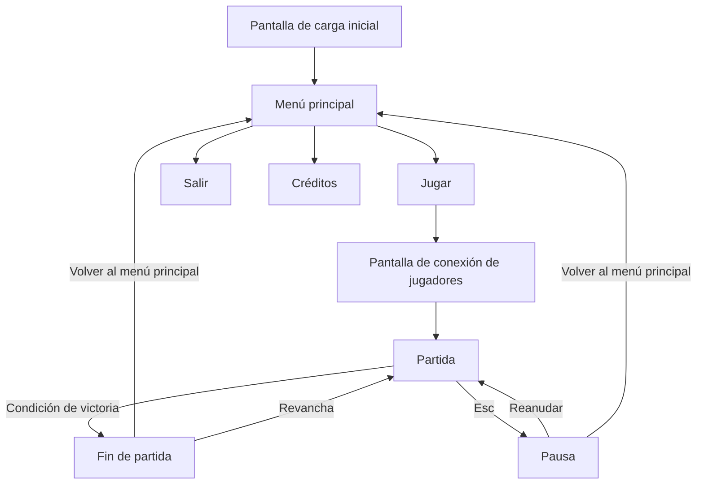

# *Jail Break — Game Design Document* 

Grupo G · Pablo Cordero Vidigal, Javier Vázquez Marinas, Daniel Álvarez Marín, Patricia López García  

# Índice

1. Introducción

2. Especificaciones básicas

3. Jugabilidad

4. Narrativa

5. Imagen y diseño visual

6. Sonido

7. Interfaz y diagrama de flujo

8. Comunicación y marketing

9. Referencias

---
1. Introducción

 1.1. Concepto del juego

Jail Break es un juego de plataformas y puzzles para dos jugadores en el que el jugador 1 juega una partida de tetris con el jugador 2 dentro de la cuadrícula, y el jugador 2 intenta que no lo aplasten. La idea principal es que el jugador 1 logre aplastar al jugador 2, y que el jugador 2 utilice las piezas del jugador 1 para escalar hasta la salida, que se encuentra en el tope del área de juego.

---
 1.2. Propuesta de valor

¿Qué hace diferente a nuestro juego? Que ofrece una experiencia completamente diferente para el jugador 1 y el 2, y un reto único para cada uno. 
Característica diferencial 1: El jugador 1 y el 2 tienen objetivos y controles completamente distintos. 
Característica diferencial 2: Es un juego competitivo para dos jugadores en línea. 
Característica diferencial 3: Existen formas de gastar puntos que cada jugador obtiene de maneras diferentes para poder fastidiar al otro jugador. 

Figura 1. Imagen promocional del juego.

---
2. Especificaciones básicas

Aspecto:  Pixelart sencillo  
Título: 	Jail Break 
Género: 	Puzzle y plataformas competitivo 
Número de jugadores:	2 (en red, tiempo real) 
Público objetivo:	Jugadores de entre 12-25 años 
Clasificación PEGI:	PEGI 7 Para todo público, no es un juego violento que muestre sangre ni es ofensivo 
Plataforma:	Navegador web (PC), desarrollado con Phaser 3 
Duración de una partida:	5-10 minutos 
Representación:	2D 
Licencia:	Apache 2.0 

---
3. Jugabilidad
 3.1. Objetivo del juego
   
El objetivo del jugador 1 es aplastar al jugador 2 antes de llegar hasta el tope de arriba.   
El objetivo del jugador 2 es llegar hasta arriba usando las piezas del jugador 1.  
La partida termina cuando el jugador 2 es aplastado o el jugador 1 se queda sin espacio (las piezas llegan hasta arriba). 

 3.2. Controles

Acciones del Jugador 1 
Mover pieza a la izquierda	`A` 
Moverse pieza a la derecha	`D` 
Seleccionar objeto 1 `1` 
Seleccionar objeto 2 `2` 
Seleccionar objeto 3 `3` 
Pausa	`Esc` 

Acciones del Jugador 2 
Moverse a la izquierda	`←` 
Moverse a la derecha	`→` 
Saltar	`↑` o `Espacio` 
Pausa	`Esc` 

 3.3. Mecánicas

 3.3.1. Mecánicas principales  
Tienda: El jugador 1 cuenta con una tienda visible en la pantalla en la cual puede comprar objetos que permiten fastidiar temporalmente al jugador 2. La "moneda" utilizada son las líneas que hagas. 

Powerups: El jugador 2 cuenta con powerups que aparecen de manera aleatoria por las casillas vacías, permitiendo al jugador 2 obtener mejoras temporales. 

Encasillado de las piezas: Las piezas del jugador 1 bajan a una velocidad de 1 casilla por segundo, y se puede mover por casillas. Esto es al contrario que el jugador 2, que se mueve de manera lineal por el escenario. 

 3.3.2. Objetos y power-ups

Jugador 1: 
Debufo de velocidad: Reduce la velocidad del Jugador 2 por 15 s. Cuesta 5 líneas. 
Debufo de salto: Reduce la altura a la que el Jugador 2 puede saltar por 15 s. Cuesta 8 líneas. 
Velocidad de piezas: Aumenta la velocidad a la que bajan las piezas por 15 s. Cuesta 12 líneas. 

Jugador 2: 
Doble salto: El jugador 2 obtiene un doble salto por 20 s. 
Generación de cuadrados: Se ponen casillas vacías grises tras 2 segundos de avisar en dónde aparecerán. 
Tienda cerrada: Evita que el jugador 1 pueda usar la tienda por 20 s. 

 3.3.3. Sistema de puntuación 
El juego no cuenta con un sistema de puntuación, sino que se considera únicamente al jugador que gana y el que pierde.  

 3.4. Físicas y dificultad 

Gravedad y salto: Se tiene una gravedad estándar para el jugador 2 y el salto lo tiene el jugador 2. Las piezas no cuentan con gravedad más allá de al momento de caer. 

Colisiones: Existen colisiones contra las piezas del jugador 1. Si el jugador 2 los toca de lado no le hacen daño, pero si lo tocan desde arriba y ya está sobre una superficie se considera aplastado y pierde la partida. De la misma forma, si al jugador 2 lo toca una pieza moviéndose de lado estando ya haciendo contacto con otra de lado, se considera aplastado también. 

Rebotes / fricción / empujes: El jugador 2 no puede empujar las piezas del jugador 1, y el jugador 1 no puede empujar al jugador 2. 

Progresión de la dificultad: a medida que avanza la partida La dificultad progresa a medida que aumenta el tiempo de la partida, ya que se obtienen más mejoras, se compran más objetos, el espacio se hace más cerrado y se hace más caótico todo. 

 3.5. Escenario 

El escenario representa una mazmorra o prisión. Es una zona única, no cambia 

Figura 2. Mapa del escenario con zonas de aparición, plataformas y obstáculos.

---
4. Narrativa

 4.1. Historia 
El jugador 2 juega como un aventurero atrapado dentro de una mazmorra mágica. El jugador 1 controla a un mago el cual va lanzando piezas para aplastarlo. 

---
5. Imagen y diseño visual 
 5.1. Logotipo 

Figura 3. Logotipo del juego. Tipografía: AAA. Concepto: AAA AAA AAA. 

 5.2. Estilo visual 

El juego utiliza un estilo pixelart básico de 32×32 píxeles. 

 5.3. Aspectos técnicos: cámara y representación 

Representación: 2D, vista lateral. 
Cámara: Fija mostrando todo el escenario. 
Resolución base: AAA × AAA píxeles. 

5.4. Bocetos de personajes y pantallas
> \*Rúbrica — Imagen / Bocetos:\* interfaz de menú, pantallas y personajes.
Los bocetos de los personajes se encuentran en el apartado 4.2 y los de las pantallas en el apartado 7.1.
---

6. Sonido
> \*Rúbrica — Sonido:\* música y efectos.
6.1. Banda sonora
Pista	Escena	Estilo / ambiente	Fuente / licencia
AAA	Menú principal	AAA (p. ej. chiptune relajado)	AAA (propia / CC-BY...)
BBB	Partida	BBB (p. ej. ritmo rápido, 140 BPM)	BBB
CCC	Victoria / derrota	CCC	CCC

 6.2. Efectos de sonido 
Efecto	Momento en que se reproduce
Salto	Al pulsar la tecla de salto
Golpe / impacto	AAA
Recoger objeto	AAA
Botones de la interfaz	Al pasar el ratón y al hacer clic
Cuenta atrás	AAA
---
7. Interfaz y diagrama de flujo
 7.2. Diagrama de flujo 

---
8. Comunicación y marketing

Público y mensaje clave: Escapa de la mazmorra usando a tu amigo. 
Canales: redes sociales (Instagram, Youtube), itch.io. 
Calendario: teaser a finales de 2026, devlog semanal todo el año, lanzamiento a mediados de 2027.
Material: tráiler, capturas, GIF de jugabilidad, press kit.
Eslogan: «Escapando una pieza a la vez».
---
9. Referencias
> \*Rúbrica — Documento / Referencias.\* Usad un formato consistente (p. ej. APA) y citadlas en el texto con \[1], \[2]...
[1] AAA, A. (Año). Título de la obra. Editorial / Estudio. URL
[2] BBB, B. (Año). Título del artículo. Revista, volumen(número), páginas. https://doi.org/AAA
[3] Schell, J. (2019). The Art of Game Design: A Book of Lenses (3.ª ed.). CRC Press.
[4] Phaser Studio. (s. f.). Phaser 3 Documentation. https://docs.phaser.io
[5] Recursos de terceros utilizados (sprites, música, fuentes): AAA — autor — licencia — URL.
